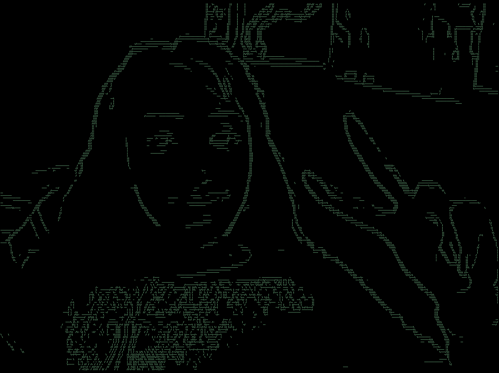

# Edge detection ASCII Mirror
 
A live webcam mirror that finds the edges in your picture and draws them as ASCII lines that follow their direction, in real time, right in the browser.
 
Instead of shading every pixel by brightness alone, this version uses **Sobel edge detection** to find where the picture changes sharply from dark to light. Each edge is drawn with the character that matches the way it runs (`|`, `/`, `-` or `\`).

## How it works
 
1. **Camera:** `getUserMedia` plays the webcam feed in a hidden `<video>` element.
2. **Shrink:** each frame is drawn onto a small hidden `<canvas>`, so one pixel equals one character.
3. **Brightness:** every pixel's red, green and blue values are combined into a single brightness from 0 to 1, and stored in a list.
4. **Sobel filter:** for each pixel, its 3 × 3 neighbourhood is compared with two kernels:
```
horizontal (sobel_x)      vertical (sobel_y)
-1  0  1                 -1 -2 -1
-2  0  2                  0  0  0
-1  0  1                  1  2  1
```
 
   `sobel_x` measures how much the brightness changes from left to right, and `sobel_y` measures how much it changes from top to bottom.
   
5. **Edge strength:** the two are combined with `√(gx² + gy²)`. A big number means a sharp change, in other words an edge.
6. **Edge direction:** `Math.atan2(gy, gx)` gives the angle the brightness changes in. An edge looks the same whichever side is bright, so the angle is folded into the range 0° to 180°.
7. **Pick a character:** the edge itself runs at right angles to the brightness change, so each angle range gets the character at 90° to it. The four characters split the 180° into four 45° slices, each centred on its ideal angle:
 
   | Brightness change | Angle range | Edge runs | Character |
   |---|---|---|---|
   | left to right | 0° to 22.5° and 157.5° to 180° | up and down | `\|` |
   | towards the bottom right | 22.5° to 67.5° | bottom left to top right | `/` |
   | top to bottom | 67.5° to 112.5° | side to side | `-` |
   | towards the bottom left | 112.5° to 157.5° | top left to bottom right | `\` |

8. **Loop:** `requestAnimationFrame` repeats this about 60 times a second.

**Have fun playing around with the value of threshhold!**

 

